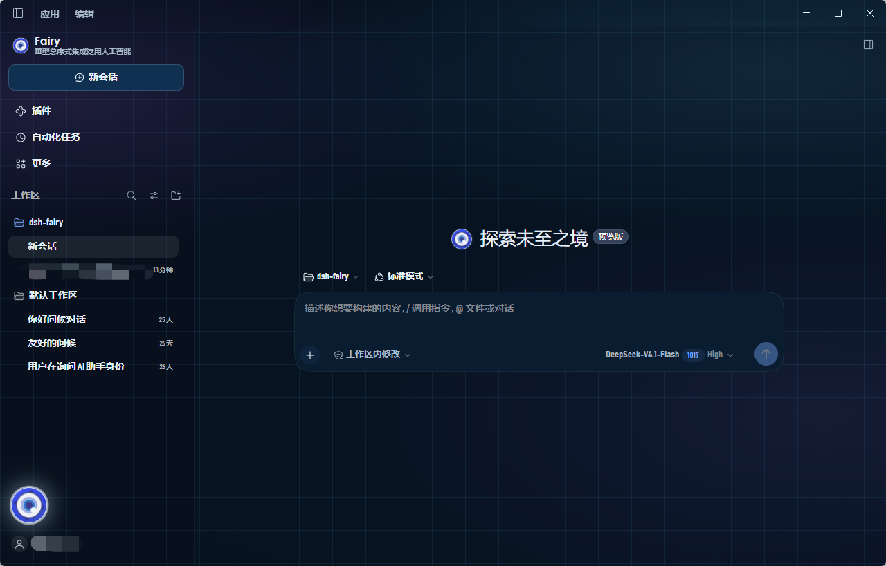

# hdd-fairy

给 **DSH 桌面版**（Electron + Cordis 插件体系）的一套 HDD 风格皮肤：开屏动画、会呼吸并周期性「撕裂」的
Fairy 徽记、按小时问候与回合提示音，外加深海军蓝的界面配色与面板纹理。

**两个前提**：① 装一个包（`dsh-skin-hdd-fairy`）就能换掉整套外观；② 素材由您自备 ——
仓库和发布件里**不含任何音视频素材**。



*启用皮肤后的新会话页。徽记就是《绝区零》里的 **Fairy**（H.D.D. 的终端形象），
本项目使用的徽记矢量取自原作插件（来历与许可状态见 `NOTICE`）；这是非官方粉丝作品，与任何游戏/公司无隶属关系。
底纹与光晕由 CSS 渐变生成，界面文字来自 DSH 壳子本身。*

## 它从哪来（非原创说明）

**设计与流程不是原创。** 「HDD 开机 → 徽记 → 问候 → 飞回侧栏」这套视觉语言，来自 UP 主
[\_天才小宇](https://space.bilibili.com/3494360513514129) 的复现视频：
<https://www.bilibili.com/video/BV1n7np6QEPe>。

原作者以**本地手工安装包**的形式发布（`private: true`、`@local/` 前缀，要手动拷进 profile 并改
`cordis.patch.yml`），没有走 npm 插件分发，所以装起来门槛高，也没法被皮肤管理器发现和切换。
本项目把这套设计做成可分发的包：**功能层重写，视觉层有直接复用**（见下）。目的只有一个：把同一件事
做成分得出来、装得进去、长期维护得下去的包。

### 复用了什么、重写了什么

| 部分 | 状态 |
|---|---|
| **徽记矢量**（`FAIRY_EMBLEM`） | **取自原作**：与原作 `FAIRY_SVG` 逐行一致（40 行里 39 行相同，仅变量名不同），渐变 id 仍是 `hddFairyOuter` / `hddFairyScleraHalo` / `hddFairyCatchHalo` |
| **部分视觉样式** | **取自原作**：网格底纹、暗角、面板遮罩、`48px` 网格，以及 `--hdd-panel-veil` / `--hdd-grid-color-veiled` / `--hdd-fx-vignette` 等变量命名 |
| 开屏时间轴、素材层（9 条 `/hdd/*` 路由）、素材设置页、提示音状态机、皮肤管理器接入、单测与 `smoke.mjs`、文档体系 | 本仓库自己实现 |
| 宿主半边（`lib/index.js`） | 自己实现；与原作重合的只有 `content-type` / `accept-ranges` 这类通用样板 |

去空白、只比对长度 > 24 的行：`lib/client.js` 与原作逐字相同的约 **11.7%**（155 / 1322），
集中在上面两处视觉层；`lib/index.js` 约 **3.4%**，全部是通用样板。

### 许可状态（重要）

原作 `INSTALL.md` 的版权表写的是「界面、代码、文档：作者原创，**可自由修改自用**」——
这授权了"改"，但**没有明确授权再次分发**。而本项目把上述复用片段放进了以 Apache-2.0 发布的包，
**这一部分尚未取得再分发授权**（待与原作者确认）。

所以：**Apache-2.0 只覆盖本仓库自己写的代码，不覆盖上表标"取自原作"的片段**；
在授权落实前，请不要把这些片段单独抽出再分发。

徽记形象的 IP 属于《绝区零》（见下文「素材与版权」与 `NOTICE`）；[Fairy-DSH](https://github.com/Chengzhibense/Fairy-DSH)
是同一条设计脉络上更早的项目，本仓库把它作为设计参考致谢，但**我们不掌握那个插件与 Fairy-DSH 之间的
确切传承关系**（待核实）。

### 与原作相比，功能上做了什么

| 方面 | 原作 | 本项目 |
|---|---|---|
| 分发 | 手工拷目录 + 手工改 profile patch | npm 包 + 皮肤管理器，`dsh plugin add` 一条命令 |
| 语音 | 实时调本机 GPT-SoVITS 朗读每条回复 | **不做实时 TTS**：问候与提示音是预生成好的静态文件，运行时不联网、不起服务 |
| 素材 | 打包在插件目录里 | **零内置**：用户自备，9 条 `/hdd/*` 路由 + 「HDD Fairy 素材」页负责导入 / 列目录 / 打开目录 |
| 提示音 | — | 按「一次运行」触发的思考 / 完成 / 失败提示音（状态机 + 跨实例去重） |
| 踩坑 | — | 白屏、窗口被压成窄列两个渲染事故的定位与修复，提炼成五条硬约束 |
| 工程 | — | 单测、`smoke.mjs`（Node 里真跑一遍客户端）、构建哈希类名解析器、文档与跨 agent 协作边界 |

## 前置条件

| 项 | 要求 / 实测范围 |
|---|---|
| DSH | 桌面版 **0.2.1-rc.3**（`skin.json#dshCompatibility` = `0.2.1rc3`） |
| 平台 | 实测 **Windows x64**（Electron 44.7 · Chromium 152）；macOS / Linux 未实测 |
| 皮肤管理器 | **必装**：[`@smalltailqwq/dsh-client-ui-skin-deep-whale-manager`](https://www.npmjs.com/package/@smalltailqwq/dsh-client-ui-skin-deep-whale-manager)。它注册「设置 → 皮肤管理」页面，负责发现、互斥切换与渲染皮肤自己的设置项；**不装就看不到任何皮肤** |
| 素材 | 不必准备。完全不放素材也能装、能用：默认**不播开屏**，直接进界面 |

版本不匹配时**预期**的结果是皮肤整块不生效（槽位或 `bodyAttr` 契约变了），而不是报错；
皮肤不碰会话数据，停用即回到原界面。

## 安装

### 〇、先装皮肤管理器（只需一次）

```powershell
dsh plugin --profile desktop add '@smalltailqwq/dsh-client-ui-skin-deep-whale-manager'
```

它是本皮肤的**前置条件**：DSH 里那个「设置 → 皮肤管理」页面由它注册；皮肤能不能被发现、能不能被切换、
皮肤自带的设置项能不能被画出来，全部由它管。**没有它，皮肤装了也不可见。**

- `--profile` 换成您自己的 profile 名（本机是 `desktop`；管理器官方示例写的是 `web`），装错 profile 等于白装；
- 装完**重启一次** DSH —— 管理器在启动时做发现与兜底检测；
- **两张皮肤不要同时启用**：管理器发现 2 套及以上皮肤同时启用，会回退到官方默认（表现是"什么都没启用"）。

安装细节、关键设置与常见问题：**[`docs/skin-manager.md`](docs/skin-manager.md)**。

**下面三种任选其一**（开发期还有第四种：直接从源码目录装）。
**每一种装完都还要多做一步**：打开 DSH → **设置 → 皮肤管理 → 切到「HDD Fairy」**。
只装不切换，看到的仍是原界面 —— 那不是安装失败。

> ⚠️ **动手前先备份** `$DSH_HOME/profiles/<profile>/package.json`。
> `dsh plugin add/remove`（插件管理器走的是同一套）会重写 profile 里的 `dsh.profile.bundles`，
> 且实测会把**其他第三方 bundle 一起从列表里丢掉**。

### 一、只填包名（最简单，已发布到 npm）

在 **插件 → 添加插件** 里填：

```
dsh-skin-hdd-fairy
```

或命令行：

```powershell
dsh plugin --profile desktop add dsh-skin-hdd-fairy
```

管理器会按 registry 上的最新版本安装，并用 `saveExact` 锁定版本。
npm 页面：<https://www.npmjs.com/package/dsh-skin-hdd-fairy>

### 二、粘贴地址安装（不依赖 npm）

在 **插件 → 添加插件** 里粘贴 Release 资源的 **`.tgz` 直链**：

```
https://github.com/nosuiyi/dsh-fairy/releases/download/v0.2.1/dsh-skin-hdd-fairy-0.2.1.tgz
```

- 必须是**文件直链**（以 `.tgz` 结尾），不是 Release 页面地址；换版本时把 `v0.2.1` 与文件名一起改掉；
- 插件管理器接受 registry 包名、**tarball URL**、Git 地址与本地路径；tarball 走 pnpm 的远程打包安装，
  不触发 GitHub 的 `git ls-remote` 预检查（该检查只针对 git 地址）；
- 仓库必须公开，否则需要额外的 Git 凭据。

### 三、下载后从本地安装

从 [GitHub Releases](https://github.com/nosuiyi/dsh-fairy/releases) 下载 `dsh-skin-hdd-fairy-<版本>.tgz`，然后：

```powershell
# 先完全退出 DSH 桌面版
dsh plugin --profile desktop add <路径>/dsh-skin-hdd-fairy-0.2.1.tgz
# 也可以在「插件 → 添加插件」里直接粘贴本机绝对路径
# 再启动 DSH → 设置 → 皮肤管理 → 切到 HDD Fairy
```

发布件只有代码、契约、文档与许可（10 个文件，`npm pack` 实测解包约 200 KB / 压缩约 60–65 KB），
**不含任何音视频素材**。
默认不播开屏、直接进界面；左下角徽记、左上角品牌位与深色配色即装即生效。
（首次启用时会把「通用设置 → 外观」切成深色——一次生效、可逆：停用时只还原它自己设过的那次。）

### 四、从源码目录安装（开发期）

```powershell
dsh plugin --profile desktop add <本仓库>/packages/dsh-skin-hdd-fairy
```

一个包就够：媒体路由、素材导入、提示音都在里面，**不需要**再补 profile patch 行。
（旧环境里若还留着 `dsh-hdd-voice` 的 `insert` 行或依赖，删掉即可；素材目录不受影响。）

## 卸载与回滚

1. **先切走**：设置 → 皮肤管理 → 切回原皮肤（或「无」）。本皮肤在 `apply(null)` 里归还它创建的一切：
   样式表、`<body>` 属性、定时器、开屏节点，以及它自己设过的那次深色外观偏好；
2. **再卸载包**：`dsh plugin --profile desktop remove dsh-skin-hdd-fairy` —— 同样会重写
   `dsh.profile.bundles`，**先备份**（见上方警告）；
3. **素材留着不会出事**：`~/.dsh/hdd-fairy/assets` 是独立目录，删不删随您；
4. **profile 被改坏**：用备份的 `package.json` 覆盖回去，重启 DSH。

## 素材放在哪

运行时不合成语音：文件提前放好，皮肤只负责读文件并播放。目录按三级解析：

| 优先级 | 来源 | 结果 |
|---|---|---|
| 1 | 环境变量 `DSH_HDD_ASSETS` | 直接使用该路径 |
| 2 | 环境变量 `DSH_HOME` | `$DSH_HOME/hdd-fairy/assets` |
| 3 | 默认 | `%USERPROFILE%\.dsh\hdd-fairy\assets` |

```
assets/
  boot.mp4 | boot.webm                                   开屏动画（可选）
  boot.png | .jpg | .webp                                开屏背景图（可选）
  field.png                                              高光板（可选）
  greeting/<dawn|morning|noon|afternoon|evening|night>/*  问候语音，按文件夹分档，文件名随意
  cue/{thinking,done,failed}.m4a                         回合提示音
```

最省事的做法是**不碰路径**：设置 → **HDD Fairy 素材** 里直接导入，会自动落进对应档位。
文件名、格式与时长建议见 [`docs/asset-convention.md`](docs/asset-convention.md)。

「打开文件夹」按钮会拉起系统文件管理器（Windows `explorer.exe` / macOS `open` / Linux `xdg-open`），
**这是本插件唯一会创建子进程的地方**；播放路径不依赖任何外部运行时、不调 TTS 服务、不读网络。

## 仓库构成

| 包 | 半边 | 状态 |
|---|---|---|
| `packages/dsh-skin-hdd-fairy` | Client + Host | **当前主力，自包含单包**：开屏、徽记、提示音、调色板、素材页，外加 9 个 `/hdd/*` 路由 |
| `packages/dsh-hdd-voice` | Host | 媒体层已并入皮肤；**不要**再为皮肤启用它（计划改造成通用语音提示包，见其 `DEPRECATED.md`） |
| `packages/dsh-hdd-visual` | Client | 早期独立版，已被皮肤取代，**不要同时启用** |

`lab/` 是一次性排查工具（探针、窗口截图脚本、旧 `client.js` 快照），**删掉不影响插件**：
它不参与构建，也不参与运行。

## 文档地图

| 文件 | 是什么 | 什么时候看 |
|---|---|---|
| [`docs/asset-convention.md`](docs/asset-convention.md) | 素材约定（文件名、格式、两种问候布局） | 准备放素材时 |
| [`docs/skin-manager.md`](docs/skin-manager.md) | 前置条件：皮肤管理器的安装、「皮肤管理」里的关键设置、常见问题 | **第一次安装时**；DSH 升级后皮肤变灰时 |
| `docs/voice-lines.final.json` / `.md` | **台词定稿**（6 档 × 3 条问候 + 3 条提示音），JSON 是权威版 | 改文案、重新生成语音时 |
| `docs/voice-render-report.md` | Edge-TTS 那版的生成报告（逐条时长与偏差） | 只想快速试听、不装 GPT-SoVITS 时 |
| `docs/tts-setup.md` | 本机 GPT-SoVITS v2 安装记录（路径、版本、坑、实测） | 重装环境或换机器时 |
| `docs/fairy-persona.md`、`docs/prompt-for-gemini.md` | 角色卡（写作版）+ 给模型的写作包 | 自己写台词时 |
| [`docs/findings-*.md`](docs/findings-2026-10-28-white-splash.md) | 四份排障记录（白屏 / 窄列 / 提示音信号 / 静态音频） | **动开屏或可视层之前必读** |
| `docs/pending-mark-tweaks.md` | 徽记尺寸与光效的可选调优（当前暂不实施） | 调徽记时 |
| `docs/bundles-watch.log` | 一次性诊断日志 | 只在查 `dsh.profile.bundles` 被谁改写时用 |
| `AGENTS.md`（根 + 两个包内各一份） | 多 agent 协作边界、跨包三条禁令、共享事实来源、验证顺序 | **接活之前先读** |
| [`packages/dsh-skin-hdd-fairy/README.md`](packages/dsh-skin-hdd-fairy/README.md) | 皮肤详版文档：设置项、素材布局、行为矩阵、面板类名解析 | **动皮肤之前先看** |

历史台词版本（`docs/voice-lines.json`、`.gemini.json`、`.gemini2.json`、`voice-lines.md`）保留作对比，
**不要拿它们生成音频**。

## 五条硬约束（改开屏 / 可视层之前）

两个事故 —— 整窗白屏、界面被压成中间一条且点不动 —— 同源：**一个全局副作用没有限定作用域**。
下面五条全部来自实测，来龙去脉与证据在
[`docs/findings-2026-10-28-white-splash.md`](docs/findings-2026-10-28-white-splash.md) 与
[`docs/findings-2026-10-28-narrow-window.md`](docs/findings-2026-10-28-narrow-window.md)。

1. **`<video>` 元素绝不能进入 DOM**（哪怕 2×2、`opacity: 0.01`）—— 否则整窗被一张白色平面盖住；
2. **开屏层不能做 `opacity` 淡入 / 淡出** —— 含视频帧 canvas 的全屏层会整层失效；
3. **开屏内部不能用 `filter`**（徽记外发光因此移除）；
4. **给 `<html>` 加标记属性时，选择器必须限定元素类型**（写 `div[data-…]`，别写 `[data-…]`）；
5. **绝不要把 `pointer-events: none` 写进可能命中 `html` / `body` 的规则**。

排查布局问题**先量数值**（`innerWidth`、`devicePixelRatio`、`visualViewport.scale`、`<html>` 的
`display` 与 `position`、`body.getBoundingClientRect()`），别先看截图 —— 一次采样就能分辨
「缩放 / DPI / 窗口真窄 / 被谁挤窄」。客户端半边可以热重载，一行改动就能在活着的页面里做实验；
但热重载后旧模块的 `setTimeout` 仍会触发，看完整开屏必须重启应用。

## 开发自检

```sh
# 1. 语法
node --check packages/*/lib/*.js packages/*/index.js

# 2. 皮肤：单测 + apply/释放
node --test packages/dsh-skin-hdd-fairy/test/asset-store.test.js
node packages/dsh-skin-hdd-fairy/tools/smoke.mjs

# 3. voice：冻结副本回归（仅当动到该包）
node --test packages/dsh-hdd-voice/test/asset-store.test.js

# 4. 台词表若改过
node tools/check-lines.mjs docs/voice-lines.final.json
```

`smoke.mjs` 会在 Node 里真跑一遍客户端半边（含完整开屏时间轴），能抓到语法检查抓不到的运行时错误 ——
这类错误曾经让一整套皮肤加载失败而界面全没。全绿才算改完；验证顺序、包的所有权与跨包禁令见
[`AGENTS.md`](AGENTS.md)。

## 素材与版权

- **本仓库不含任何音视频素材。** 发布件（npm 包 / Release 资产）只有代码、契约、文档与许可；
  开屏动画、背景图、高光板、问候语音与提示音一律由用户自备。
  仓库里唯一的图片是 `docs/assets/screenshot.png` —— 本文顶部的效果截图，不随包分发
  （`files` 白名单里没有 `docs/`）。图里的徽记是《绝区零》的 **Fairy**（H.D.D. 的终端形象），
  徽记矢量取自原作插件、形象属于《绝区零》，来历与声明见 `NOTICE`；本项目**不主张任何相关 IP 的权利**。
- **示例音频只在作者本机生成，用于演示，不随发布件分发。** `docs/voice-lines.*` 与
  `docs/voice-render-report.md` 记录的是台本文本与生成过程，不是音频文件。
- **自备素材时请确认您有权使用：**
  - **音色** —— 用您自己的声音，或用已获授权 / 已订阅的语音合成服务；**不要**克隆并分发未授权的角色音色
    （尤其是游戏角色原声）；
  - **文本** —— 台词请自己撰写或改写，不要直接搬运作品原文；
  - **音乐与音效** —— 使用可商用或已获授权的素材。
- **本仓库不附带、也不分发 GPT-SoVITS 权重、参考录音或任何训练数据**；需要本地复现请自行准备，
  并遵守相应项目与数据的许可。
- **这不是官方作品。** 本项目与任何游戏 / 公司无隶属关系，请勿据此声称官方授权，也不要用于商业用途。
- **设计与灵感的来源**见上文「它从哪来（非原创说明）」：视觉语言来自 UP 主 _天才小宇 的视频与插件，
  徽记矢量与部分视觉样式直接取自那个插件，形象属于《绝区零》—— 本项目对它们均无所有权，
  也不代替它们的授权。

## 许可

代码 Apache-2.0（见根目录 `LICENSE`；皮肤包另有 `packages/dsh-skin-hdd-fairy/LICENSE` 与 `NOTICE`，
后者记录徽记矢量的来历（取自原作插件）、Fairy-DSH 的设计参考与商标声明）。
本仓库**不含**任何游戏美术、字体或音频素材；素材由用户自备，其权利归提供者。
